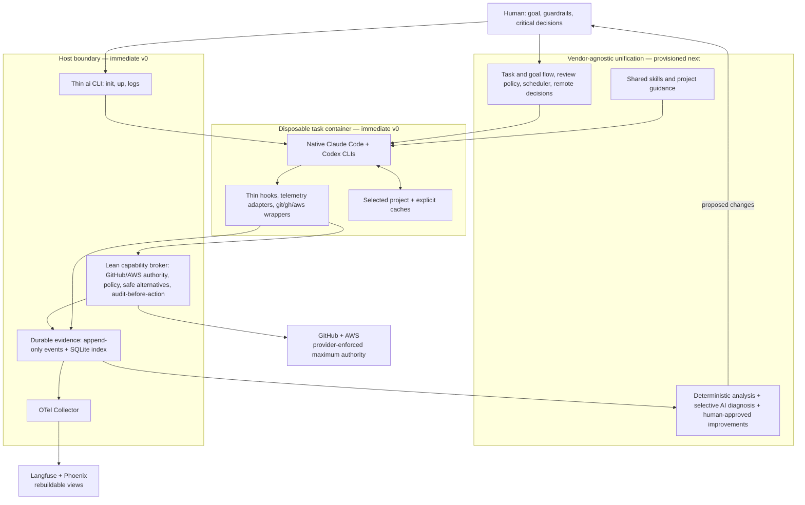

# AI Crew localdev pivot

## Decision

AI Crew localdev becomes a secure local substrate for native coding agents, not another coding-agent harness.

Its core outcome is:

> Start Claude Code or Codex in one command inside an isolated rootless Podman environment, let the agent work freely on the project, prevent durable or excessive access to external systems, and persist enough correlated evidence to understand and improve the work later.

Claude Code and Codex run unmodified and retain their native user experience, reasoning, sessions, subagents, skills, hooks, reviews, and context management. AI Crew localdev supplies the vendor-agnostic unification and durability layer around them: a common launch boundary, external capabilities, evidence, shared guidance, and later cross-agent flows and improvement analysis.

This layer stays lean and should shrink whenever native harnesses absorb a capability. It retains only the common behavior needed to bring the harnesses to a consistent operating baseline and the cross-agent capabilities that no individual harness can own.

## Change in intent

The previous design treated AI Crew localdev as a governed development workflow with agent identities, custom plans, managed runs, private workspaces, an apply step, budgets, and provider-specific orchestration.

That is no longer the product.

Native agent CLIs now provide the agent loop and extension mechanisms well enough. Recreating those features adds latency, maintenance, and cognitive load without strengthening the important boundaries. The new design composes with native CLIs through their supported hooks, skills, configuration, structured output, and OpenTelemetry interfaces.

The product is now deliberately narrower:

- Rootless Podman protects the host and limits the project-visible filesystem.
- A host capability broker protects GitHub, AWS, and future external systems.
- Wrappers give agents safe, predictable command semantics while provider-side policy remains authoritative.
- A local evidence pipeline correlates native telemetry, logs, external capabilities, and repository state.
- A shared unification layer gradually adds portable skills, cross-agent flows, and measured improvement without replacing either native runtime.

## Decision priorities

Within the non-negotiable security and evidence invariants, use this order to direct product investment and resolve competing improvements:

1. Durable traceability with broad correlated context and no silent loss of required evidence.
2. Fast autonomous progress toward useful outcomes with low human attention cost.
3. Simple, reliable operation with a small understandable surface.
4. Enforceable security appropriate to each project's risk surface, including protection from irreversible external actions.
5. Efficient token, cache, model, and infrastructure use.
6. Continuous, measured improvement of skills, rules, routing, and development flow.
7. Extensibility and compatibility with additional agents or legacy workflows.

Backward compatibility is not a reason to preserve the current architecture. Generality is added only after a second concrete use case proves it is needed.

Every operational trade-off must have a measurable budget, emitted evidence, and deterministic failure policy. Security and governance paths fail closed; optional observability destinations may fail without stopping local work because canonical evidence remains local.

## Ownership boundary

| Concern | Native Claude Code and Codex | AI Crew localdev |
|---|---|---|
| Reasoning, coding, planning, subagents, context, review | Own | Do not duplicate |
| Interactive and non-interactive agent UX | Own | Launch unchanged |
| Skills and project instructions | Load and execute | Curate and synchronize later |
| Tool lifecycle integration | Expose hooks and structured events | Install thin adapters |
| Project execution isolation | Secondary native safeguards | Rootless Podman is the default boundary |
| GitHub and AWS authority | Consume short-lived capabilities | Hold durable authority and enforce maximum scope |
| External writes | Request intent | Classify, record, approve, and execute on the host |
| Telemetry production | Emit native OTel and structured events | Correlate, persist, normalize, and fan out |
| Cross-agent flow and improvement | No shared ownership | Build later from measured local evidence |

Native hooks improve the interaction and can rewrite or annotate tool calls, but they are not the security boundary. An agent with broad access inside its container can bypass a wrapper. External security therefore comes from host custody, provider-enforced permissions, short lifetimes, repository protection, and host-mediated write actions.

## System boundary and provisioned scope



The native CLIs own each agent loop. The task container is the execution boundary. The broker remains deliberately narrow: it holds external authority, applies deterministic capability policy, chooses declared safe alternatives, and durably records decisions before external actions. Shared prompts, goal shaping, review procedures, and project conventions belong in portable skills or generated native instructions rather than in broker code.

## Immediate v0

The first usable version contains only three foundations.

### 1. Easy rootless Podman environment

The initial operator surface is:

```text
ai init
ai up [--task <label>] [-- <native-command>]
ai logs [run-id]
```

`ai init` creates a small project profile and an optional project Containerfile. `ai up` validates its own prerequisites, builds or reuses the project image, starts or attaches to a task-scoped container, assigns a run ID, and connects the broker and telemetry endpoints. With no native command it opens a shell; for example, `ai up --task feature-a -- codex` starts Codex as the first process.

The task label is correlation context, not a v0 goal specification or an agent identity. Every supported native CLI is available in the same container, so Claude can later act as reviewer, advisor, or fallback for work started with Codex. V0 does not orchestrate those roles; the provisioned cross-agent flow does.

The container mounts only the selected project, explicitly declared caches, isolated Claude/Codex login state, and the broker socket. It never mounts the operator's home, SSH agent, AWS configuration, GitHub configuration, or sibling repositories. Dependency and CLI-login volumes survive container replacement; the container itself is disposable.

The agent has high trust inside the container and can install dependencies, run arbitrary project tools, and change project files without routine approval prompts. That trust does not extend to the host or external systems.

### 2. GitHub and AWS capability boundary

Long-lived GitHub App keys, AWS refresh credentials, private keys, and equivalent authority remain on the host.

The container receives a repository-scoped read-only GitHub token and a short-lived AWS STS session for one project-approved role. AWS sessions use the run ID as source identity, deny role chaining, and are read-only by default. Provider-side permissions are the final maximum authority even if a wrapper is bypassed.

GitHub writes never receive a write token inside the container. The v0 host gateway supports only normal append-only pushes, draft pull-request creation or update, and comments on the bound pull request. It resolves the repository and branch itself, rejects force pushes, branch deletion, unexpected refspecs, and non-descendant history, records authorization durably, then performs the action with a host-only short-lived credential.

Published history is append-only. Review corrections are follow-up or revert commits; amend, rebase of published work, hard-reset removal, force push, and administrative bypass are outside the supported path.

The `git`, `gh`, and `aws` wrappers classify intent and select one deterministic result:

- Allow a permitted read.
- Replace the request with a semantically equivalent restricted invocation.
- Run a project-declared safe alternative.
- Submit a supported host action.
- Request human approval when that capability exists later.
- Refuse when no safe alternative exists.

Safe alternatives are explicit argv arrays in host-controlled policy, never shell fragments or guesses generated from the attempted command. The wrapper always states whether the original action occurred. Unexpected privilege attempts and every redirect are recorded with the original action class, selected alternative, goal or run context, and outcome.

### 3. Durable telemetry and logs

Every launch receives a stable run ID. The evidence pipeline captures:

- Native Claude/Codex OpenTelemetry signals.
- Native hook and structured CLI events.
- Agent stdout and stderr where the interface exposes them safely.
- Container lifecycle and image/configuration identity.
- Broker credential issuance, policy decisions, redirects, and host actions.
- Repository, branch, commit, agent, model, session, token, cache, timing, and result context.

Raw append-only event files are the complete replayable record. SQLite is the searchable run, audit, and correlation index. An ingestion acknowledgement is not successful until required local evidence is durable.

The local OpenTelemetry path normalizes the minimum common session, turn, model, and tool structure and sends it through an OTel Collector to both Langfuse and Phoenix. Those systems are rebuildable views used side by side; neither is the source of truth. Raw transcripts and prompt or response content are opt-in, redacted where configured, and retention-bounded.

The agent CLIs already expose the extension points required for this boundary: Codex provides hooks and OTel configuration, while Claude Code provides hooks and detailed OTel monitoring. Langfuse and Phoenix both accept OTLP traces. These are integration contracts, not functionality for this repository to recreate.

## v0 exclusions

The following are intentionally not part of the first foundation:

- Goal or specification workflow.
- Cross-model or adversarial review orchestration.
- Scheduler, rate-limit recovery, or unattended continuation.
- Mobile approvals or Telegram integration.
- Meta-optimizer, retrospectives, findings experiments, or automatic skill updates.
- AWS write operations.
- Hard token or cost budgets.
- Per-agent identity.
- Gemini support.
- Private checkout and apply workflow.
- Worktree policy or other prescribed development methodology.
- Devcontainer overlay generation, Docker compatibility, or general environment orchestration.
- Generic provider, plugin, or policy frameworks without a proven second implementation.

The evidence schema reserves optional goal, slice, skill, rule, decision, and review identifiers so later layers do not require a telemetry redesign.

## Provisioned v1 direction

These layers are built on measured v0 usage and remain outside the broker and native agent loops.

1. A small shared source of skills and project guidance synchronized into native Claude and Codex extension points, including lightweight goal shaping, project setup, quality checks, and review procedures.
2. Lightweight iterative goals based on a short JTBD statement, explicit constraints, the next testable slice, and recorded goal pulses rather than an exhaustive initial specification.
3. Cross-agent orchestration that can assign a primary agent and use another as reviewer, advisor, or rate-limit fallback while keeping the task and evidence continuous.
4. Review depth selected by risk and prior attempts, with a hard stop after three unsuccessful review rounds. At that point an advanced model performs an architecture-level meta-review and sends the human a concise informational report; another rejected round or an inconclusive meta-review stops autonomous work and requests a human decision.
5. Shared limit recovery, cancellable scheduling, and concise remote human decisions that interrupt only for blocked or critical choices.
6. A meta-optimizer that combines deterministic aggregation and anomaly detection with selective AI diagnosis and human-approved skill, rule, and routing experiments.

These layers consume the foundation; they do not expand the authority of the container or replace native agent loops.

## Implementation strategy

The v0 implementation starts greenfield inside this repository. The current implementation is frozen as a source of tested primitives and security lessons, not refactored into the new shape.

The new code must not import legacy orchestration, workspace, identity, launcher, devcontainer, or Langfuse-provider packages. Small proven pieces may be extracted after focused review: GitHub signing and permission-subset logic, secure atomic persistence, audit-before-action behavior, and useful native telemetry parsing.

The intended v0 is approximately 3,000 to 5,000 production Go lines across fewer than ten product packages, plus Containerfile and OTel Collector configuration. This is a design constraint, not a quota: exceeding it requires a concrete security or operability justification.

Once v0 passes its end-to-end proofs, legacy code and obsolete active documentation are removed in normal append-only commits. Repository history remains the archive; no history is rewritten.

## Proof of alignment

The v0 foundation is complete only when automated checks demonstrate all of the following:

- A new project can start Claude Code or Codex through one documented path.
- The container cannot access host GitHub or AWS durable credentials, the operator home, or unrelated repositories.
- GitHub reads work, direct writes fail, and the host gateway performs only recorded append-only writes.
- AWS access uses the configured role, short lifetime, run source identity, and provider-enforced maximum permissions.
- Wrapper bypass cannot increase provider authority, and unexpected privileged intent produces durable evidence.
- Required audit evidence is durable before credentials or host actions are released.
- Agent, container, broker, repository, token, cache, timing, and policy evidence is correlated under the same run ID.
- A run remains inspectable locally when Langfuse, Phoenix, or the network is unavailable.
- The same normalized run can be inspected in both Langfuse and Phoenix.
- Container replacement preserves only the explicitly intended CLI login and dependency caches.
- Claude Code and Codex remain native, upgradeable components rather than forked or reimplemented runtimes.

Any proposed feature that does not strengthen these proofs or build directly on their evidence is outside the current product focus.
