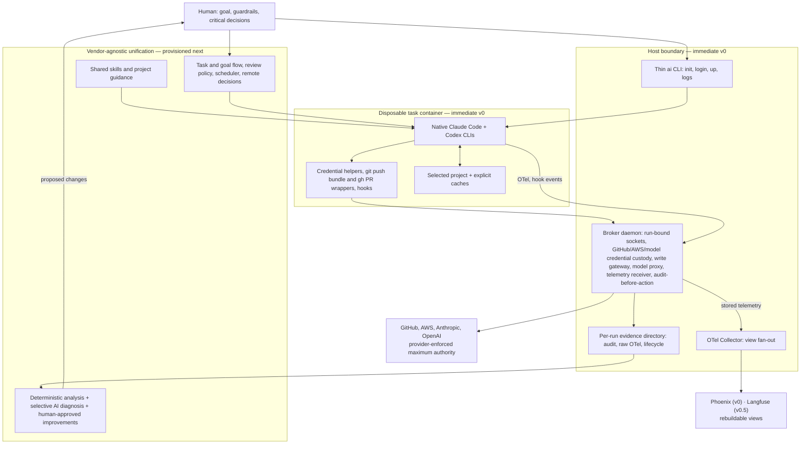

# AI Crew localdev pivot

## Decision

AI Crew localdev becomes a secure local substrate for native coding agents, not another coding-agent harness.

Its core outcome is:

> Start Claude Code or Codex in one command inside an isolated rootless Podman environment, let the agent work freely on the project, prevent durable or excessive access to external systems, and persist enough correlated evidence to understand and improve the work later.

Claude Code and Codex run unmodified and retain their native user experience, reasoning, sessions, subagents, skills, hooks, reviews, and context management. AI Crew localdev supplies the vendor-agnostic unification and durability layer around them: a common launch boundary, external capabilities, evidence, shared guidance, and later cross-agent flows and improvement analysis.

This layer stays lean and should shrink whenever native harnesses absorb a capability. It retains only the common behavior needed to bring the harnesses to a consistent operating baseline and the cross-agent capabilities that no individual harness can own.

## Change in intent

The previous design treated AI Crew localdev as a governed development workflow with agent identities, custom plans, managed runs, private workspaces, an apply step, budgets, and provider-specific orchestration.

That is no longer the product.

Native agent CLIs now provide the agent loop and extension mechanisms well enough. Recreating those features adds latency, maintenance, and cognitive load without strengthening the important boundaries. The new design composes with native CLIs through their supported hooks, skills, configuration, structured output, and OpenTelemetry interfaces.

The product is now deliberately narrower:

- Rootless Podman protects the host and limits the project-visible filesystem.
- A host capability broker holds GitHub, AWS, model-provider subscription, and future external authority and gives the container only placeholders or short-lived, provider-scoped credentials.
- Thin write wrappers route the few supported external writes to the host, while provider-side permissions remain authoritative.
- A local evidence pipeline correlates native telemetry, broker audit, container lifecycle, and repository state under one run ID.
- A shared unification layer gradually adds portable skills, cross-agent flows, and measured improvement without replacing either native runtime.

## Decision priorities

Within the non-negotiable security and evidence invariants, use this order to direct product investment and resolve competing improvements:

1. Durable traceability with broad correlated context and no silent loss of required evidence.
2. Fast autonomous progress toward useful outcomes with low human attention cost.
3. Simple, reliable operation with a small understandable surface.
4. Enforceable security appropriate to each project's risk surface, including protection from irreversible external actions.
5. Efficient token, cache, model, and infrastructure use.
6. Continuous, measured improvement of skills, rules, routing, and development flow.
7. Extensibility and compatibility with additional agents or legacy workflows.

Backward compatibility is not a reason to preserve the current architecture. Generality is added only after a second concrete use case proves it is needed.

Every operational trade-off must have a measurable budget, emitted evidence, and deterministic failure policy. Security and governance paths fail closed; optional observability destinations may fail without stopping local work because canonical evidence remains local.

## Ownership boundary

| Concern | Native Claude Code and Codex | AI Crew localdev |
|---|---|---|
| Reasoning, coding, planning, subagents, context, review | Own | Do not duplicate |
| Interactive and non-interactive agent UX | Own | Launch unchanged |
| Skills and project instructions | Load and execute | Curate and synchronize later |
| Tool lifecycle integration | Expose hooks and structured events | Install thin adapters |
| Model-provider login | Own the login flow and request format | Hold subscription credentials on the host; the container sees only placeholders |
| Project execution isolation | Secondary native safeguards | Rootless Podman is the default boundary |
| Network egress | Not owned | Open in v0, restricted mode in v0.5 |
| GitHub and AWS authority | Consume short-lived capabilities | Hold durable authority and enforce maximum scope |
| External writes | Request intent | Record, enforce scope, and execute on the host |
| Telemetry production | Emit native OTel and structured events, with every content switch on | Stamp correlation context on arrival, persist as received without filtering, fan out |
| Cross-agent flow and improvement | No shared ownership | Build later from measured local evidence |

Native hooks improve the interaction and can rewrite or annotate tool calls, but they are not the security boundary. An agent with broad access inside its container can bypass a wrapper. External security therefore comes from host custody, provider-enforced permissions, short lifetimes, and host-mediated write actions.

## System boundary and provisioned scope



The native CLIs own each agent loop. The task container is the execution boundary. The broker remains deliberately narrow: it holds external authority, applies deterministic capability policy, and durably records decisions before external actions. Shared prompts, goal shaping, review procedures, and project conventions belong in portable skills or generated native instructions rather than in broker code.

## Immediate v0

The first usable version contains only three foundations.

### 1. Easy rootless Podman environment

The initial operator surface is:

```text
ai init
ai login <claude|codex>
ai up [--task <label>] [-- <native-command>]
ai logs [run-id]
```

`ai init` creates a small project profile and an optional project Containerfile. `ai up` validates its own prerequisites, builds or reuses the project image, starts or attaches to a task-scoped container, and connects the broker and telemetry endpoints. With no native command it opens a shell; for example, `ai up --task feature-a -- codex` starts Codex as the first process.

A run is one task container's lifetime. The first `ai up --task <label>` creates the container and its run ID; later `ai up` calls with the same label attach to that container and record an attach event in the same run. Replacing the container, for example after an image change, starts a new run that shares the task label. Native session IDs nest inside the run, so Codex as primary and Claude as reviewer in one container share one run. The run ID is the only identifier AI Crew introduces: it names the broker socket, the evidence directory, the OTel resource attribute, and the AWS source identity, so it uses letters, digits, and hyphens within 64 characters.

The task label is correlation context, not a v0 goal specification or an agent identity. Every supported native CLI is available in the same container, so Claude can later act as reviewer, advisor, or fallback for work started with Codex. V0 does not orchestrate those roles; the provisioned cross-agent flow does.

V0 allows one task container per checkout. A second task on the same checkout fails with a message to use another clone or worktree; v0 does not create or manage worktrees.

The container mounts only the selected project at `/workspaces/<project>`, explicitly declared caches, the dedicated Claude and Codex home volumes, and its own broker socket. The project-specific mount path keeps native session histories distinct per project. Each agent-home volume is the CLI's complete native config home, selected through its config-home variable so that all native state, including Claude's home-root settings file, lands inside the volume. Volumes are mounted as directories, never as single files, because the CLIs replace their files by atomic rename. The container never mounts the operator's home, host agent login state, SSH agent, AWS configuration, GitHub configuration, or sibling repositories. Dependency and agent-home volumes survive container replacement; the container itself is disposable.

Agent-home volumes hold native settings and session history but never real model-provider credentials; section 2 defines model-provider custody.

V0 egress is open, and each run records its egress mode. Exposure is bounded because every credential in the container is either a placeholder or short-lived and read-scoped. The v0.5 restricted mode replaces this with an allowlisted host proxy.

The agent has high trust inside the container and can install dependencies, run arbitrary project tools, and change project files without routine approval prompts. That trust does not extend to the host or external systems.

### 2. External capability boundary

Long-lived GitHub App keys, AWS refresh credentials, private keys, and equivalent authority remain on the host in one broker daemon, which `ai up` starts as a user service when it is absent.

`ai up` asks the broker for a run-bound socket before starting the container and mounts only that socket. The broker fixes the repository, branch prefix, and AWS role for the socket's lifetime and derives all authority from the socket a request arrives on; requests never name a repository or role. The socket is removed when the container stops. Rootless Podman maps container processes to the operator's UID, so peer credentials cannot tell containers apart and are not used for authorization.

The container obtains credentials through native helper interfaces backed by its socket. A git credential helper and the `gh` wrapper fetch a repository-scoped read-only GitHub token on demand, and AWS `credential_process` returns a short-lived STS session for the project-approved role. Helpers refresh on expiry, so no real credential is stored in the container's persistent environment or on disk. AWS sessions use the run ID as source identity, deny role chaining, and are read-only by default. Provider-side permissions are the final maximum authority even if a helper or wrapper is bypassed.

Model-provider subscription credentials are host-held for both CLIs, and this is a v0 requirement. `ai login claude` and `ai login codex` run the native login in a short-lived login container whose volume only the broker reads; task containers never mount it. Claude uses a `claude setup-token` subscription token. The agent-home volumes contain only placeholder credentials, and each CLI reaches its provider through a model proxy behind the run socket, exposed on container loopback by a minimal forwarder where a CLI requires an HTTP URL. The image entrypoint starts the loopback forwarders as container root and then drops to the agent user, so the agent cannot stop them; the operator's UID maps to that agent user, so mounted sockets and agent homes are owned by it. The proxy replaces the placeholder with the real credential and performs any token refresh on the host, so a placeholder copied out of the container cannot reach the provider. The proxy fails closed: if the broker is unavailable, agents cannot reach their models. Binding a model credential to a run is audit evidence; the proxy records no request or response content, and usage metrics come from native telemetry.

Subscription authentication formats are vendor internals, not published contracts. CLI versions are pinned in the image and upgraded only after an automated compatibility check against the model proxy passes.

A spike precedes the model proxy. It confirms that each CLI works with placeholder credentials and host-side refresh across a CLI upgrade without forged tokens, and that substituting credentials for the genuine CLI is consistent with each vendor's current consumer terms. Each CLI that passes is a supported agent. A CLI that fails is unsupported: `ai up` refuses to launch it, its delivery is deferred until the human revisits the decision, and it never falls back to real credentials inside the container. The v0 proofs apply to every supported agent, and v0 needs at least one; if neither CLI passes, v0 stops for a decision.

GitHub writes never receive a write token inside the container. The v0 host gateway supports only normal append-only pushes within the run's branch prefix, by default `ai/<task>/`, draft pull-request creation or update, and comments on the bound pull request. It resolves the repository and branch itself, rejects force pushes, branch deletion, unexpected refspecs, and non-descendant history, records authorization durably, then performs the action with a host-only short-lived credential.

Host-side Git never runs against the agent-writable checkout, whose repository state can redirect a push and its credential (`url.<base>.insteadOf`), run host programs (hooks, fsmonitor, filters, `gpg.program`), or pull in host objects (`objects/info/alternates`). Instead, the `git push` wrapper builds a bundle of the new commits inside the container and sends it over the run socket, refused above 100 MiB. The broker imports the bundle into a host-owned bare repository per project, refreshed from GitHub so the bundle's prerequisites exist, using the extracted hardened Git runner with its own configuration, and pushes from there after the checks above. Adversarial tests prove that a permitted push runs no planted hook or configured program, sends no credential to a redirected URL, and carries no object from a host path outside the run.

V0 assumes the GitHub Free tier, where private repositories have no rulesets or branch protection, so the host gateway alone enforces push scope. Provider-side push rules are deferred until evidence shows the gateway is insufficient.

Branch-prefix limits constrain publication, not execution. A push to `ai/**` can trigger CI that runs agent-written code with repository secrets and runner access. The gateway's write credential omits GitHub's `workflows` permission, so agent pushes cannot change workflow definitions, but existing workflows still run. Each destination project must keep privileged secrets, deployment credentials, and self-hosted runners away from workflows triggered by unreviewed branches, or explicitly accept that exposure. Validating CI configuration is outside scope.

Published history is append-only. Review corrections are follow-up or revert commits; amend, rebase of published work, hard-reset removal, force push, and administrative bypass are outside the supported path.

The `gh` wrapper injects a fresh read token into every invocation; `git push`, `gh pr create`, `gh pr edit`, and `gh pr comment` are the only calls routed to the host. Each wrapped call has one of three deterministic results: run a permitted read, submit a supported host action, or refuse with a hint naming the supported path. The wrapper always states whether the original action occurred. Native hooks may give the same guidance earlier, but neither hooks nor wrappers are enforcement: a bypassed wrapper meets a read-only token. Host-action refusals are audit evidence; attempted commands are visible through hook telemetry.

### 3. Durable evidence and telemetry

Evidence has two classes with different guarantees.

Audit evidence covers credential issuance, policy decisions, refusals, and host actions. The broker appends it to the run's audit file and fsyncs before releasing a credential or performing an action; if the write fails, the action fails.

Telemetry covers native Claude and Codex OpenTelemetry signals and hook events. Native exporters do not wait for acknowledgement, so this class is best-effort; loss the run socket observes, including any record it cannot store, is counted per run and shown by `ai logs`, and pruning is recorded, so nothing is silently discarded. The CLIs export logs and spans every second and metrics every 10 seconds, so a killed container loses only what it produced in its last export interval.

Telemetry collection and telemetry use are separate layers with separate responsibilities.

- Collection captures everything each native CLI can emit, as raw as the CLI provides it, and adds a deterministic `ai.*` correlation context stamped by the host. It never filters, redacts, samples, or reshapes on write. That content already passes between the environment and the model provider, so recording it locally adds no new exposure. Collection is responsible for completeness, correct correlation, owner-only local storage, and its storage budget.
- Use is where content risk is decided. Each consumer, such as Phoenix, `ai logs`, or a later meta-analyser, filters or redacts on read according to its own risk. A consumer that sends evidence to an AI model or off the host applies its own read-side filter; a local-only analyser may read everything. Stored evidence is never rewritten to suit a consumer, so stricter or more permissive consumers can be added later without recollecting.

`ai up` therefore turns on every content switch each CLI offers, including prompts, responses, tool input and output, and raw API bodies. The switches, exporters, and endpoints are pinned in managed settings baked into the image, which override the agent-writable user settings, the repository's settings, the process environment, and command-line overrides, so the agent cannot turn collection off or divert it, even by starting a CLI itself. AI Crew's own hook adapters record native hook payloads as received, with the same correlation context. Every v0 destination is local: the evidence directory is owner-only and Phoenix listens only on localhost.

Collection is mandatory, and evidence lives in one per-user root shared by all projects, so cross-project history is always available. The initial telemetry budget is 5 GiB overall, configurable per user. `ai up` enforces it before each run by deleting the oldest inactive runs' telemetry files and recording each deletion in the evidence root, and refuses to start a run when active runs alone exceed it; audit and run lifecycle files are never pruned automatically. `ai up` refuses to start a run when the evidence volume has less than 1 GiB free. An audit write failure latches the broker's audit logger, and the broker refuses further credentials and host actions until storage is fixed and the broker restarts. A telemetry write failure loses telemetry without stopping the agent, and the run's failure counters are shown by `ai logs`.

Each run has one directory:

```text
pruning.jsonl   telemetry deletions made by the budget, recorded before each deletion
runs/<run-id>/
  audit.jsonl   broker decisions and host actions, fsynced before release
  otel.jsonl    OTLP JSON with the stamped context, appended by the run socket before it acknowledges each request
  run.jsonl     container lifecycle, attach events, image, configuration, egress mode, run-socket telemetry counters
```

Correlation happens on arrival. Each CLI exports OTLP to container loopback, which reaches the host only through the run socket. The host side of the run socket stamps the `ai.*` context on every request: run ID, task label, agent and its pinned version, project, repository, branch, image digest, and egress mode. The run socket writes that context onto each record's resource, replacing any value the container supplied for those attributes, and appends the record to the run's `otel.jsonl` before acknowledging the request. A process in the container therefore cannot attribute records to another run, every acknowledged record is stored, every refused or unstorable one is counted, and no later join is needed. Hook adapters receive the same context through their environment. Telemetry is stored without reshaping; mapping to a common session, turn, model, and tool shape happens at read or analysis time, so vendor schema changes never corrupt stored evidence. Mapping never invents values: an attribute a CLI did not emit stays absent rather than zero, and read-side filters are checked against stored records rather than against the names a configuration claims to cover.

Native session transcripts stay in the agent-home volumes and are referenced by session ID.

An OTel Collector fed from the run socket fans the stored stream out to Phoenix, the v0 view. The Collector is not on the evidence path: its file exporter acknowledges buffered writes, truncates files it reopens, and keeps pruned files open, so it cannot provide the storage guarantees above. Phoenix is rebuildable and not the source of truth; a run remains inspectable through `ai logs` when Phoenix or the network is unavailable.

The native telemetry spike in `docs/spikes/native-telemetry.md` records which signals each pinned CLI emits, which settings layers can override telemetry configuration, and why the run socket rather than the CLI carries the correlation context. If Phoenix needs spans that a CLI does not emit, the conversion lives in Collector configuration where possible and in Go only when necessary, and it is applied on the way to Phoenix, never to stored evidence.

The agent CLIs already expose the extension points required for this boundary: Codex provides hooks and OTel configuration, while Claude Code provides hooks and detailed OTel monitoring. These are integration contracts, not functionality for this repository to recreate.

## Accepted v0 risks

- Project content can leave the container through open egress.
- While a run is live, a compromised agent can spend subscription quota through the model proxy.
- A compromised agent can use its read-only GitHub token and AWS read session for their lifetime.
- A vendor change to subscription authentication can stop a CLI until the proxy is updated; pinned versions bound this to upgrades.
- CI triggered by `ai/**` pushes runs agent-written code with whatever authority the destination project's workflows grant.
- Telemetry can be lost before it reaches the host; loss the run socket observes is counted, not prevented.
- Telemetry holds the full content exchanged with model providers, including command input and output and any secrets they carry. It stays on the owner-only local disk alongside the native transcripts; consumers that send it elsewhere filter on read.

## Alternatives considered

| Decision | Chosen | Alternatives and why not now |
|---|---|---|
| Run identity | Container lifetime | Per launch splits one task's agents across runs. Per task label is not unique and spans replaced containers. |
| Broker authorization | One host daemon, one socket per container, authority from the socket | A shared socket with a bearer token puts a reusable secret in the container. A per-run broker process has no supervisor for detached containers. Peer credentials cannot distinguish rootless containers. |
| Model logins | Host custody with placeholder credentials and a run-socket model proxy | Real tokens in agent-home volumes expose durable account credentials and account standing to any compromised agent. Injecting a scoped token as an environment variable still places a long-lived token in the container. Per-project volumes add logins without reducing exposure. API-key billing is out of scope. |
| Egress | Open in v0, allowlisted proxy in v0.5 | Restricting from day one blocks dependency installs before the allowlist is learned from evidence. A logging-only proxy is incomplete because tools can ignore proxy settings. |
| GitHub writes | Host gateway only | Rulesets are unavailable for private repositories on the Free tier and are deferred until proven needed. A write token in the container would also permit arbitrary pull-request and comment writes. |
| Host Git publication | Bundle imported into a host-owned bare repository | Hardened Git on the mounted checkout cannot neutralize agent-written repository configuration or object indirection. A broker `git receive-pack` endpoint works but exposes a larger protocol surface. |
| Telemetry filtering | None on write; collection is complete and each consumer filters on read | Turning content off at the source or filtering in the Collector discards evidence that a later local-only analyser could use and ties stored evidence to one consumer's risk. Reusing the legacy Go relay adds a second ingest path; the run socket already terminates OTLP, so it stores records itself and the Collector keeps the configuration-only fan-out to views. |
| Telemetry storage | The run socket appends stamped OTLP JSON before acknowledging | The pinned Collector file exporter acknowledges buffered writes and ignores flush errors, truncates a file it reopens unless append is set, cannot combine append with unbuffered writes, and keeps pruned files open, so acknowledged records could disappear. |
| Views | Phoenix in v0, Langfuse in v0.5 | Both in v0 adds a six-service Langfuse deployment to `ai up` and a second span mapping before the first is stable. |

## v0.5

v0.5 follows once v0 passes its proofs and adds only what v0 evidence shows is missing:

- Langfuse as a second Collector destination, after the span mapping is stable against Phoenix.
- A SQLite index rebuilt from run directories, for search and correlation across runs.
- Restricted egress: an internal Podman network whose only route out is a host proxy with a profile allowlist and a per-run destination log.
- Wrapper rewrites and project-declared safe alternatives, as explicit argv arrays in host policy, if refusal evidence shows agents repeatedly need them.

## v0 exclusions

The following are intentionally not part of the first foundation:

- Langfuse, the SQLite index, restricted egress, and wrapper rewrites, which are v0.5.
- Goal or specification workflow.
- Cross-model or adversarial review orchestration.
- Scheduler, rate-limit recovery, or unattended continuation.
- Mobile approvals or Telegram integration.
- Meta-optimizer, retrospectives, findings experiments, or automatic skill updates.
- AWS write operations.
- Provider-side push rules such as GitHub rulesets or branch protection.
- Hard token or cost budgets.
- Per-agent identity.
- Gemini support.
- Private checkout and apply workflow.
- Worktree policy or other prescribed development methodology.
- Devcontainer overlay generation, Docker compatibility, or general environment orchestration.
- Generic provider, plugin, or policy frameworks without a proven second implementation.

Evidence uses an open `ai.*` attribute namespace, so later layers add attributes such as goal, skill, or review identifiers without a schema redesign.

## Provisioned v1 direction

These layers are built on measured usage and remain outside the broker and native agent loops. Each starts only when run evidence shows its trigger.

1. A small shared source of skills and project guidance synchronized into native Claude and Codex extension points, including lightweight goal shaping, project setup, quality checks, and review procedures. Trigger: the same guidance is maintained separately for each CLI.
2. Lightweight iterative goals based on a short JTBD statement, explicit constraints, the next testable slice, and recorded goal pulses rather than an exhaustive initial specification. Trigger: runs abandoned or redirected because the goal was unclear.
3. Cross-agent orchestration that can assign a primary agent and use another as reviewer, advisor, or rate-limit fallback while keeping the task and evidence continuous. Trigger: measured rate-limit stalls or repeated manual cross-agent review.
4. Review depth selected by risk and prior attempts, with a hard stop after three unsuccessful review rounds. At that point an advanced model performs an architecture-level meta-review and sends the human a concise informational report; another rejected round or an inconclusive meta-review stops autonomous work and requests a human decision. Trigger: runs with repeated review rounds.
5. Shared limit recovery, cancellable scheduling, and concise remote human decisions that interrupt only for blocked or critical choices. Trigger: human wait time dominates run duration.
6. A meta-optimizer that combines deterministic aggregation and anomaly detection with selective AI diagnosis and human-approved skill, rule, and routing experiments. Trigger: deterministic aggregation shows recurring failure patterns across runs.

These layers consume the foundation; they do not expand the authority of the container or replace native agent loops.

## Implementation strategy

The v0 implementation starts greenfield inside this repository. The current implementation is frozen as a source of tested primitives and security lessons, not refactored into the new shape.

The new code must not import legacy orchestration, workspace, identity, launcher, devcontainer, or Langfuse-provider packages. Proven mechanisms are extracted after focused review, together with their focused tests, rather than rebuilt:

- Git hardening: the hardened runner and environment in `internal/runtime/workspace/git.go` and the metadata-indirection checks in `internal/runtime/workspace/workspace.go`, with `TestCheckpointAndApplyIgnoreAgentControlledGitConfiguration`, `TestApplyDoesNotRunSourceHooks`, and `TestCheckpointRejectsGitMetadataEscapesBeforeGitRuns`.
- Durable audit: `FileAuditLogger` in `internal/broker/core/fileaudit.go` and `internal/platform/securefile`, with the persist-before-return, failure-latching, and unsafe-target tests.
- GitHub App signing and permission-subset logic in `internal/providers/github`.
- Shared-guidance installation in `internal/app/agentdefaults`, with its tests, held for the v1 shared-guidance layer rather than v0.

The intended v0 is approximately 2,500 to 3,500 production Go lines across about five product packages, plus Containerfile and OTel Collector configuration. This is a design constraint, not a quota: exceeding it requires a concrete security or operability justification.

Once v0 passes its end-to-end proofs, legacy code and obsolete active documentation are removed in normal append-only commits. Repository history remains the archive; no history is rewritten.

## Proof of alignment

The v0 foundation is complete only when automated checks demonstrate all of the following for every supported agent:

- A new project can start each supported agent through one documented path, and `ai up` refuses an unsupported agent.
- The container cannot access host GitHub or AWS durable credentials, the operator home, host agent login state, or unrelated repositories.
- A request on one run's socket cannot obtain credentials or act for another repository, branch prefix, or AWS role.
- The container holds no real model-provider credential, and a placeholder copied out of the container cannot reach the provider.
- Supported agents reach their models only through the model proxy, and model access stops when the broker is unavailable.
- A CLI upgrade is adopted only after the model-proxy compatibility check passes.
- GitHub reads work, direct writes fail at the provider, and the host gateway performs only recorded append-only writes within the run's branch prefix.
- A permitted push runs no planted hook or configured program on the host, sends no credential to a redirected URL, and carries no object from a host path outside the run.
- The gateway write credential lacks workflow permission, and a push that changes workflow definitions is rejected.
- AWS access uses the configured role, short lifetime, run source identity, and provider-enforced maximum permissions.
- Bypassing a wrapper or helper cannot increase provider authority.
- Audit evidence is durable before any credential or host action is released, and an audit write failure blocks the action.
- Native telemetry, broker audit, and container lifecycle for a run carry the same run ID and land in one run directory.
- Each supported agent runs with every content switch on and pinned against agent and repository overrides, every stored record carries the host-stamped `ai.*` context, and Phoenix is reachable only from localhost.
- Telemetry the run socket refuses or cannot store is counted per run and visible in `ai logs`.
- The overall telemetry budget, recorded pruning, the free-space floor, and audit write failure follow the stated policy deterministically.
- A run remains inspectable locally when Phoenix or the network is unavailable and appears in Phoenix when it is available.
- Each run records its egress mode.
- Container replacement preserves only the agent-home volumes and declared caches, starts a new run with the same task label, and lets supported agents start without re-onboarding and resume prior sessions.
- A second task container on the same checkout is refused.
- Supported agents remain native, upgradeable components rather than forked or reimplemented runtimes.

Any proposed feature that does not strengthen these proofs or build directly on their evidence is outside the current product focus.
